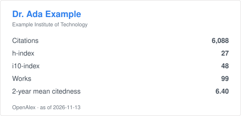

<div align="center">

# scholar-cards

**Your citations, h-index and most cited papers as cards for your homepage or GitHub profile, kept fresh by a
GitHub Action.** The numbers come from [OpenAlex](https://openalex.org) (open, no account needed), each traceable to
the API record it came from; the cards are self-contained SVG, light, dark, or following the reader's system setting.

<a href="https://github.com/zch6a/scholar-cards/actions/workflows/ci.yml"></a>


<a href="LICENSE"></a>

**English** · [简体中文](README.zh-CN.md)

</div>

---

GitHub profiles have stats cards; researchers' homepages (al-folio, academicpages, Hugo Academic) have a citation
count typed in by hand and months out of date. scholar-cards makes the cards from your OpenAlex record and a
scheduled workflow keeps them current.

<p align="center">
  
  
  
</p>

<sub>A made-up researcher ([examples/scholar.json](examples/scholar.json)); yours come from OpenAlex.</sub>

## Use

```bash
uvx --from git+https://github.com/zch6a/scholar-cards scholar-cards search "Your Name"
```

lists the author records OpenAlex has for that name (IDs, ORCIDs, institutions, counts). OpenAlex sometimes splits one person
into several records; pick the one with your ORCID, or the largest; the tool never picks for you. Then:

```bash
scholar-cards A5023888391 -o cards/          # or your ORCID: 0000-0002-1825-009X
```

writes `cards/stats.svg`, `cards/works.svg`, `cards/citations.svg` and `cards/scholar.json` (the numbers, the date,
the API URLs they came from). Put them in a page:

```markdown

```

`--theme auto` follows the reader's system colour scheme. To follow the theme a reader picked on GitHub, write both
(`--theme light,dark`) and let GitHub choose:

```html
<picture>
  <source media="(prefers-color-scheme: dark)" srcset="cards/stats-dark.svg">
  
</picture>
```

| option | |
|---|---|
| `--cards stats,works,citations` | which cards (default: all three) |
| `--theme auto\|light\|dark` | `auto` follows the reader's colour scheme; `light,dark` writes both (`stats-light.svg`, `stats-dark.svg`) |
| `--lang en\|zh` | the labels |
| `--top N` | papers on the works card (default 5) |
| `--snapshot scholar.json` | render again from a snapshot, without the network |

No API key is needed: a profile takes two requests. A key from OpenAlex (free) in `OPENALEX_API_KEY` raises the
daily budget; it is sent as a header, never in a URL, and never written to the snapshot.

## Kept fresh by a GitHub Action

In your homepage's repository, `.github/workflows/scholar-cards.yml`:

```yaml
on:
  schedule: [{ cron: "0 6 * * 1" }]   # every Monday
  workflow_dispatch:
permissions:
  contents: read
concurrency: scholar-cards             # one run at a time: a manual run cannot race the weekly one
jobs:
  cards:                               # fetches and renders, with a read-only token
    runs-on: ubuntu-latest
    steps:
      - uses: zch6a/scholar-cards@v0
        with:
          author: A5023888391          # or your ORCID
          out: cards
      - uses: actions/upload-artifact@v4
        with: { name: cards, path: cards/ }
  commit:                              # commits them; runs nothing but git
    needs: cards
    runs-on: ubuntu-latest
    permissions:
      contents: write
    steps:
      - uses: actions/checkout@v4
      - run: rm -rf cards                # cards no longer made (a theme dropped) go too
      - uses: actions/download-artifact@v4
        with: { name: cards, path: cards/ }
      - run: |
          git add -A cards
          git diff --cached --quiet && exit 0
          git -c user.name=scholar-cards -c user.email=actions@users.noreply.github.com commit -m "Update scholar cards"
          git push
```

The job that can write to your repository runs no code of this tool; the one that runs it cannot write. If you change
`out`, change the `cards/` paths in the commit job to match. Expect a commit each run: the date on the cards changes. Pin the
actions to commits if your repository's policy asks for it. For al-folio or academicpages, point `out` at a folder of
its own that the site serves (`assets/img/scholar-cards/`, never `assets/img/` itself: the commit job empties that
folder each run) and use the cards as images. A push made by a workflow does not start other workflows, so a site
that deploys on push (al-folio does) publishes the new cards at its next deploy; to deploy at once, add
`gh workflow run <your deploy workflow>` to the commit job, with `actions: write` in its permissions. al-folio's own dark-mode switch does not change the
reader's system setting, so there `theme: light` or `dark` (matching the site) reads better than `auto`.

## Who cites a paper, and what they say: `scholar-cards cited`

Citation counts say how many; `cited` says who and in what words. It lists the papers that cite one paper (an arXiv
id, a DOI or a Semantic Scholar id), newest first, with the sentences that cite it, from Semantic Scholar's public
API (only the paper's id is sent). With `--new` it remembers the citing papers it has seen in a state file and lists
only the new ones, so a weekly workflow can open an issue for them.

```console
$ scholar-cards cited arXiv:2312.00752 --limit 1000
Mamba: Linear-Time Sequence Modeling with Selective State Spaces: 1000 citing paper(s) of 10,263 counted by Semantic Scholar
  with the sentences that cite it: 759; contrasts with 98, compares with 62, builds on 227, mentions 1086; claims to beat it: 0
...
2026-10-08  [builds on]       MemReg: Streaming Outdoor LiDAR Point Cloud Registration with Hybrid Memory Buffers
            “In this paper, we adopt the vanilla Mamba architecture [34] in our temporal encoding layer as illustrated in Fig.”  (builds on: we adopt)
2026-09-01  [contrasts with]  Towards Efficient and Effective Unimodal Trajectory Representation Learning: A Simple Yet Powerful Approach · IJCAI/ECAI
            “Although current Mamba [Gu and Dao, 2023] architectures offer linear complexity, since standard SSMs are inherently causal, this architecture fails to capture the non-causal topological dependencies intrinsic to road networks.”  (contrasts with: Although)
```

Each sentence gets a label from rules on its words, shown with the word that decided it: **builds on** ("we adopt",
"based on", "follows", "backbone"), **compares with** ("baseline", "outperforms", "we compare", a result with ±),
**contrasts with** ("however", "although", "fails to", "lacks"), or **mentions**. They are hints, not judgements: on
40 sentences citing Mamba, drawn at random and read by hand, the label matched the reading for 27 (builds on 6 of 10,
contrasts with 1 of 4, compares with 1 of 1, mentions 19 of 25); "whereas" and "unlike" often describe rather than
disagree. A first version did worse (25 of 40, on another sample) and is what the rules were corrected on: "rather
than" counted as a comparison, "follows" and "as in" were missed, and "Gu et al. proposed..." was taken for the
citing authors' own claim. A citing paper that says, in its own voice, that it outperforms the cited one is listed as
"claims to beat it".

Semantic Scholar has the citing sentences for part of the citing papers (759 of Mamba's first 1,000), and its public
API is often busy: `cited` waits and asks again (5, 20, 60, 120 s), and a free key in `S2_API_KEY` makes it reliable.
`--format markdown` gives a table for an issue; `--format json` everything.

```yaml
# .github/workflows/cited.yml: every Monday, an issue listing the week's new citations of your paper
on:
  schedule: [{cron: "0 7 * * 1"}]
  workflow_dispatch:
permissions:
  contents: write   # to commit the state file (the citing papers already seen)
  issues: write
jobs:
  cited:
    runs-on: ubuntu-latest
    steps:
      - uses: actions/checkout@3d3c42e5aac5ba805825da76410c181273ba90b1 # v7.0.1
      - uses: astral-sh/setup-uv@68559e99cc807c1eb7e9238fd43a15bba460eec2 # v10.3.3
      - env:
          GH_TOKEN: ${{ github.token }}
          S2_API_KEY: ${{ secrets.S2_API_KEY }}   # optional
        run: |
          if ! uvx --from git+https://github.com/zch6a/scholar-cards@v0 scholar-cards cited arXiv:2312.00752 \
               --new --state cited/state.json --format markdown --fail-on-new > news.md; then
            gh issue create --title "New citations" --body-file news.md
          fi
          git config user.name github-actions; git config user.email github-actions@users.noreply.github.com
          git add cited/state.json && git commit -m "cited: state" && git push || true
```

## What the numbers are

| | |
|---|---|
| Citations, works | OpenAlex's counts for the author record |
| h-index, i10-index, two-year mean citedness | OpenAlex's `summary_stats` |
| Citations per year | OpenAlex's `counts_by_year` (the last ten years); the current year is faded and marked "so far" |
| Most cited papers | the author's works by citations, with venue and year |

They differ from Google Scholar's (which counts more sources, some of them not papers) and from Scopus'. The cards
say "OpenAlex" and the date; `scholar.json` lists the exact API URLs.

## Limits

- The numbers are OpenAlex's: a split or merged author record, or a paper attributed to the wrong person, shows on the
  cards as it is there. Fix it at OpenAlex (it accepts corrections), and the next run picks it up.
- One author record per card; records split across several IDs are not added up.
- OpenAlex's own data has errors: a search can return a record whose name is several people's, and an ORCID can lead
  to someone else's record. The tool prints whom it fetched, and warns when the record's ORCID is not the one asked.

## Also in this toolkit

[paper-proof](https://github.com/zch6a/paper-proof) checks a paper's references and numbers;
[submit-check](https://github.com/zch6a/submit-check) checks it against a venue's rules;
[arxiv-diff](https://github.com/zch6a/arxiv-diff) shows what changed between versions;
[exp-tables](https://github.com/zch6a/exp-tables) turns results into tables with honest bold.

## Part of research-kit

One of thirteen open research tools, from reading papers to after publication. All of them, in the order of
the work, with one Claude Code plugin marketplace for their skills: [research-kit](https://github.com/zch6a/research-kit)
· [site](https://zch6a.github.io/research-kit/).

## License

MIT
