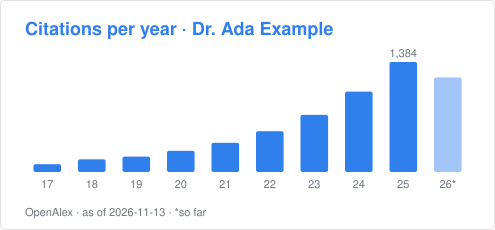

<div align="center">

# scholar-cards

**Your citations, h-index and most cited papers as cards for your homepage or GitHub profile, kept fresh by a
GitHub Action.** The numbers come from [OpenAlex](https://openalex.org) (open, no account needed), each traceable to
the API record it came from; the cards are self-contained SVG, light, dark, or following the reader's system setting.

<a href="https://github.com/zch6a/scholar-cards/actions/workflows/ci.yml"></a>


<a href="LICENSE"></a>

**English** · [简体中文](README.zh-CN.md)

</div>

---

GitHub profiles have stats cards; researchers' homepages (al-folio, academicpages, Hugo Academic) have a citation
count typed in by hand and months out of date. scholar-cards makes the cards from your OpenAlex record and a
scheduled workflow keeps them current.

<p align="center">
  
  
  
</p>

<sub>A made-up researcher ([examples/scholar.json](examples/scholar.json)); yours come from OpenAlex.</sub>

## Use

```bash
uvx --from git+https://github.com/zch6a/scholar-cards scholar-cards search "Your Name"
```

lists the author records OpenAlex has for that name (IDs, ORCIDs, institutions, counts). OpenAlex sometimes splits one person
into several records; pick the one with your ORCID, or the largest; the tool never picks for you. Then:

```bash
scholar-cards A5023888391 -o cards/          # or your ORCID: 0000-0002-1825-009X
```

writes `cards/stats.svg`, `cards/works.svg`, `cards/citations.svg` and `cards/scholar.json` (the numbers, the date,
the API URLs they came from). Put them in a page:

```markdown

```

`--theme auto` follows the reader's system colour scheme. To follow the theme a reader picked on GitHub, write both
(`--theme light,dark`) and let GitHub choose:

```html
<picture>
  <source media="(prefers-color-scheme: dark)" srcset="cards/stats-dark.svg">
  
</picture>
```

| option | |
|---|---|
| `--cards stats,works,citations` | which cards (default: all three) |
| `--theme auto\|light\|dark` | `auto` follows the reader's colour scheme; `light,dark` writes both (`stats-light.svg`, `stats-dark.svg`) |
| `--lang en\|zh` | the labels |
| `--top N` | papers on the works card (default 5) |
| `--snapshot scholar.json` | render again from a snapshot, without the network |

No API key is needed: a profile takes two requests. A key from OpenAlex (free) in `OPENALEX_API_KEY` raises the
daily budget; it is sent as a header, never in a URL, and never written to the snapshot.

## Kept fresh by a GitHub Action

In your homepage's repository, `.github/workflows/scholar-cards.yml`:

```yaml
on:
  schedule: [{ cron: "0 6 * * 1" }]   # every Monday
  workflow_dispatch:
permissions:
  contents: read
jobs:
  cards:                               # fetches and renders, with a read-only token
    runs-on: ubuntu-latest
    steps:
      - uses: zch6a/scholar-cards@v0
        with:
          author: A5023888391          # or your ORCID
          out: cards
      - uses: actions/upload-artifact@v4
        with: { name: cards, path: cards/ }
  commit:                              # commits them; runs nothing but git
    needs: cards
    runs-on: ubuntu-latest
    permissions:
      contents: write
    steps:
      - uses: actions/checkout@v4
      - uses: actions/download-artifact@v4
        with: { name: cards, path: cards/ }
      - run: |
          git add cards
          git diff --cached --quiet && exit 0
          git -c user.name=scholar-cards -c user.email=actions@users.noreply.github.com commit -m "Update scholar cards"
          git push
```

The job that can write to your repository runs no code of this tool; the one that runs it cannot write. If you change
`out`, change the `cards/` paths in the commit job to match. Expect a commit each run: the date on the cards changes. Pin the
actions to commits if your repository's policy asks for it. For al-folio or academicpages, point `out` at a folder
the site serves (`assets/img/` for example) and use the cards as images.

## What the numbers are

| | |
|---|---|
| Citations, works | OpenAlex's counts for the author record |
| h-index, i10-index, two-year mean citedness | OpenAlex's `summary_stats` |
| Citations per year | OpenAlex's `counts_by_year` (the last ten years); the current year is faded and marked "so far" |
| Most cited papers | the author's works by citations, with venue and year |

They differ from Google Scholar's (which counts more sources, some of them not papers) and from Scopus'. The cards
say "OpenAlex" and the date; `scholar.json` lists the exact API URLs.

## Limits

- The numbers are OpenAlex's: a split or merged author record, or a paper attributed to the wrong person, shows on the
  cards as it is there. Fix it at OpenAlex (it accepts corrections), and the next run picks it up.
- One author record per card; records split across several IDs are not added up.
- OpenAlex's own data has errors: a search can return a record whose name is several people's, and an ORCID can lead
  to someone else's record. The tool prints whom it fetched, and warns when the record's ORCID is not the one asked.

## Also in this toolkit

[paper-proof](https://github.com/zch6a/paper-proof) checks a paper's references and numbers;
[submit-check](https://github.com/zch6a/submit-check) checks it against a venue's rules;
[arxiv-diff](https://github.com/zch6a/arxiv-diff) shows what changed between versions;
[exp-tables](https://github.com/zch6a/exp-tables) turns results into tables with honest bold.

## License

MIT
