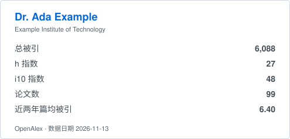
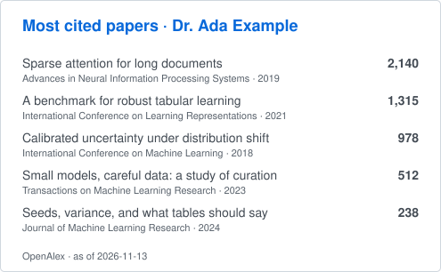
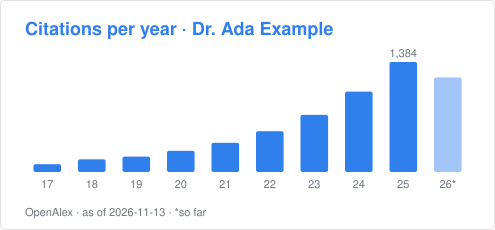

<div align="center">

# scholar-cards

**把你的被引次数、h 指数和高被引论文做成卡片，放到个人主页或 GitHub 主页，并由 GitHub Action 定时更新。** 数据来自
[OpenAlex](https://openalex.org)（开放数据，无需注册），每个数字都能追溯到对应的 API 记录；卡片是自包含的 SVG，可以是亮色、暗色，或跟随读者的系统设置。

<a href="https://github.com/zch6a/scholar-cards/actions/workflows/ci.yml"></a>


<a href="LICENSE"></a>

[English](README.md) · **简体中文**

</div>

---

GitHub 主页有统计卡片；学者主页（al-folio、academicpages、Hugo Academic）上的被引数却是手动填的，常常过时好几个月。
scholar-cards 从你的 OpenAlex 记录生成卡片，定时工作流让它们保持最新。

<p align="center">
  
  
  
</p>

<sub>虚构的学者（[examples/scholar.json](examples/scholar.json)）；你的数据来自 OpenAlex。</sub>

## 用法

```bash
uvx --from git+https://github.com/zch6a/scholar-cards scholar-cards search "Your Name"
```

列出 OpenAlex 里这个名字对应的作者记录（ID、ORCID、机构、论文数与被引数）。OpenAlex 有时会把一个人拆成几条记录：选带你 ORCID 的那条，
或者最大的那条；工具不会替你挑。然后：

```bash
scholar-cards A5023888391 -o cards/          # 或者你的 ORCID：0000-0002-1825-009X
```

会写出 `cards/stats.svg`、`cards/works.svg`、`cards/citations.svg` 和 `cards/scholar.json`（数字、日期，以及数据来源的 API 地址）。放进页面：

```markdown

```

`--theme auto` 跟随读者的系统配色。如果要跟随读者在 GitHub 上选的主题，两种都生成（`--theme light,dark`），让 GitHub 来选：

```html
<picture>
  <source media="(prefers-color-scheme: dark)" srcset="cards/stats-dark.svg">
  
</picture>
```

| 选项 | |
|---|---|
| `--cards stats,works,citations` | 生成哪些卡片（默认三张都要） |
| `--theme auto\|light\|dark` | `auto` 跟随读者的配色；`light,dark` 两种都写（`stats-light.svg`、`stats-dark.svg`） |
| `--lang en\|zh` | 卡片上的文字 |
| `--top N` | 高被引论文卡上的论文数（默认 5） |
| `--snapshot scholar.json` | 从快照重新生成，不联网 |

不需要 API key：一份主页只要两次请求。在 `OPENALEX_API_KEY` 里放一个 OpenAlex 的免费 key 可以提高每日额度；它只放在请求头里，
不会出现在 URL 中，也不会写进快照。

## 用 GitHub Action 定时更新

在你的主页仓库里建 `.github/workflows/scholar-cards.yml`：

```yaml
on:
  schedule: [{ cron: "0 6 * * 1" }]   # 每周一
  workflow_dispatch:
permissions:
  contents: read
concurrency: scholar-cards             # 同一时间只跑一个：手动运行不会和每周的那次冲突
jobs:
  cards:                               # 用只读权限取数并生成卡片
    runs-on: ubuntu-latest
    steps:
      - uses: zch6a/scholar-cards@v0
        with:
          author: A5023888391          # 或者你的 ORCID
          out: cards
      - uses: actions/upload-artifact@v4
        with: { name: cards, path: cards/ }
  commit:                              # 提交卡片；只运行 git
    needs: cards
    runs-on: ubuntu-latest
    permissions:
      contents: write
    steps:
      - uses: actions/checkout@v4
      - run: rm -rf cards                # 不再生成的卡片（比如去掉了某个主题）也一并删掉
      - uses: actions/download-artifact@v4
        with: { name: cards, path: cards/ }
      - run: |
          git add -A cards
          git diff --cached --quiet && exit 0
          git -c user.name=scholar-cards -c user.email=actions@users.noreply.github.com commit -m "Update scholar cards"
          git push
```

能写你仓库的那个任务不运行本工具的任何代码；运行本工具的任务没有写权限。改了 `out` 的话，提交任务里的 `cards/` 路径也要一起改。每次运行通常都会产生一次提交：卡片上的日期会变。如果你的仓库要求，把 action 固定到具体提交。
用 al-folio 或 academicpages 时，把 `out` 指向网站会发布的一个专用目录（例如 `assets/img/scholar-cards/`，不要用 `assets/img/` 本身：提交任务每次运行都会清空这个目录），把卡片当图片用。工作流推送的提交不会触发其他工作流，所以靠推送部署的网站（al-folio 就是）要等下次部署才会发布新卡片；想立刻部署，在提交任务里加上 `gh workflow run <你的部署工作流>`，并给它 `actions: write` 权限。al-folio 自带的暗色开关不会改变读者的系统设置，所以在那里用与网站一致的 `theme: light` 或 `dark` 比 `auto` 更合适。

## 这些数字是什么

| | |
|---|---|
| 总被引、论文数 | OpenAlex 对这条作者记录的统计 |
| h 指数、i10 指数、近两年篇均被引 | OpenAlex 的 `summary_stats` |
| 逐年被引 | OpenAlex 的 `counts_by_year`（最近十年）；当年淡化并标为“截至目前” |
| 高被引论文 | 作者的论文按被引排序，附期刊/会议与年份 |

它们和 Google Scholar（收录来源更多，其中有些不是论文）、Scopus 的数字不同。卡片上写明了“OpenAlex”和日期；`scholar.json` 里有确切的 API 地址。

## 局限

- 数字就是 OpenAlex 的：作者记录被拆分或合并、论文归错了人，卡片上会原样显示。到 OpenAlex 更正（它接受更正），下次运行就会更新。
- 一张卡片对应一条作者记录；拆成多个 ID 的记录不会被加总。
- OpenAlex 自己的数据有错：搜索可能返回一条名字是好几个人的记录，ORCID 也可能指到别人的记录。工具会打印取到的是谁，记录里的 ORCID 与你给的不一致时会警告。

## 同一套工具

[paper-proof](https://github.com/zch6a/paper-proof) 检查论文的参考文献与数字；[submit-check](https://github.com/zch6a/submit-check) 按会议规则检查论文；
[arxiv-diff](https://github.com/zch6a/arxiv-diff) 显示版本之间改了什么；[exp-tables](https://github.com/zch6a/exp-tables) 把实验结果变成只在有依据时才加粗的表格。

## 属于 research-kit

这是 13 个开源科研工具之一，覆盖从读论文到论文发表之后。全部工具按科研流程的介绍，以及安装它们技能的 Claude Code 插件市场，见 [research-kit](https://github.com/zch6a/research-kit) · [网站](https://zch6a.github.io/research-kit/)。

## 许可证

MIT
